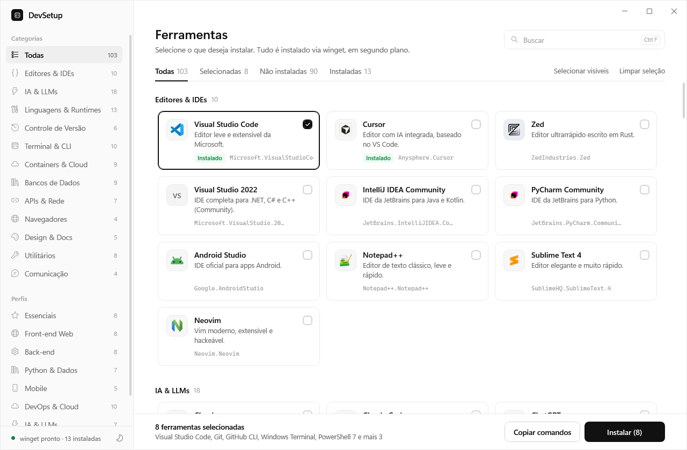
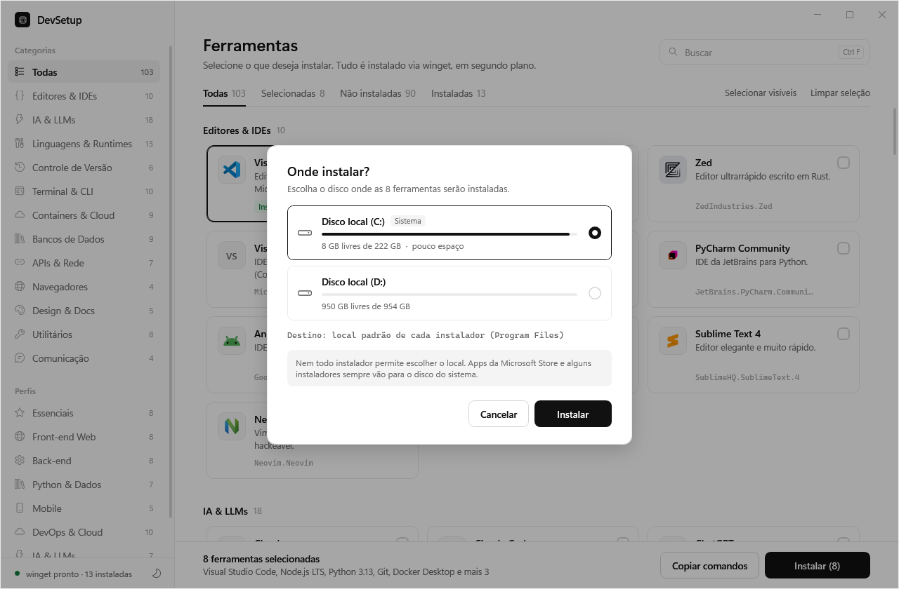
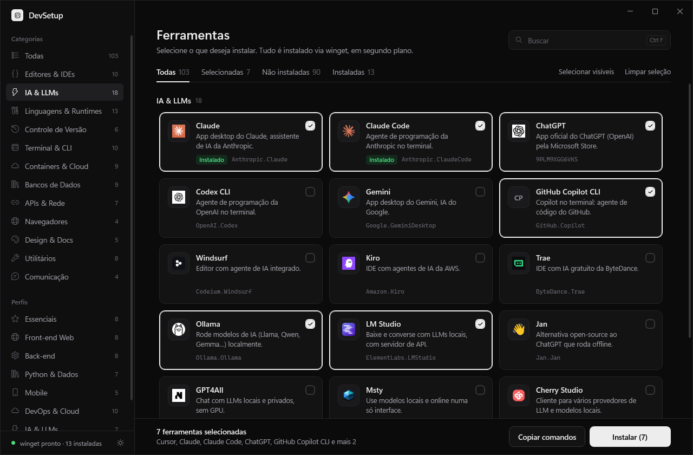

# DevSetup

Instalador visual para montar um ambiente de desenvolvimento no Windows. Escolha as ferramentas e instale tudo de uma vez, em modo silencioso, via **winget**.



## Como usar

1. Baixe o repositório (**Code → Download ZIP**) ou use `git clone`.
2. Dê dois cliques em **`Iniciar DevSetup.bat`**.
3. Selecione as ferramentas nos cartões ou escolha um **perfil** na barra lateral.
4. Clique em **Instalar** e escolha o **disco de destino**.

> Dica: execute como administrador (botão direito → *Executar como administrador*) para evitar um pedido de UAC por instalador.



## Recursos

- **103 ferramentas** em 12 categorias: editores, IA & LLMs, linguagens, Git, terminal, containers e cloud, bancos de dados, APIs, navegadores, design, utilitários e comunicação
- **Perfis**: Essenciais, Front-end, Back-end, Python & Dados, Mobile, DevOps & Cloud, IA & LLMs, Java & .NET
- **Escolha do disco**: instale em `D:\DevTools` (ou outro disco) em vez do disco do sistema
- **Detecta o que já está instalado** e filtra por *Todas*, *Selecionadas*, *Não instaladas* e *Instaladas*
- **Progresso por ferramenta** e log detalhado
- **Tema claro e escuro**: segue o Windows e pode ser alternado no canto inferior da barra lateral
- **Copiar comandos**: gera os comandos `winget install` da seleção
- Busca com `Ctrl+F` e link para o site oficial de cada ferramenta



## Sobre a escolha do disco

Em outro disco, cada ferramenta vai para `<disco>:\DevTools\<nome>` (opção `--location` do winget). Nem todo instalador aceita um local personalizado: apps da Microsoft Store e alguns instaladores sempre vão para o disco do sistema.

## Personalizar

Tudo vem de **`tools.json`**:

```json
{ "id": "Git.Git", "name": "Git", "category": "Controle de Versão",
  "desc": "Controle de versão distribuído + Git Bash.", "site": "https://git-scm.com", "keywords": "git bash" }
```

- `id`: identificador do winget (descubra com `winget search <nome>`)
- `source` (opcional): `msstore` para apps da Microsoft Store; o padrão é `winget`
- logo (opcional): salve um PNG em `icons/<id>.png`; sem logo, aparecem as iniciais
- `presets`: listas de IDs usadas nos perfis

## Requisitos

- Windows 10/11
- winget (*Instalador de Aplicativo* da Microsoft Store)
- Windows PowerShell 5.1 (já vem no Windows)

## Estrutura

| Arquivo | Função |
| --- | --- |
| `Iniciar DevSetup.bat` | Atalho para abrir o app |
| `DevSetup.ps1` | Lógica: catálogo, filtros, temas, detecção e instalação em segundo plano |
| `MainWindow.xaml` | Interface WPF |
| `tools.json` | Catálogo de ferramentas e perfis |
| `icons/` | Logos das ferramentas |

Os logos pertencem às respectivas marcas e são usados apenas para identificação.
