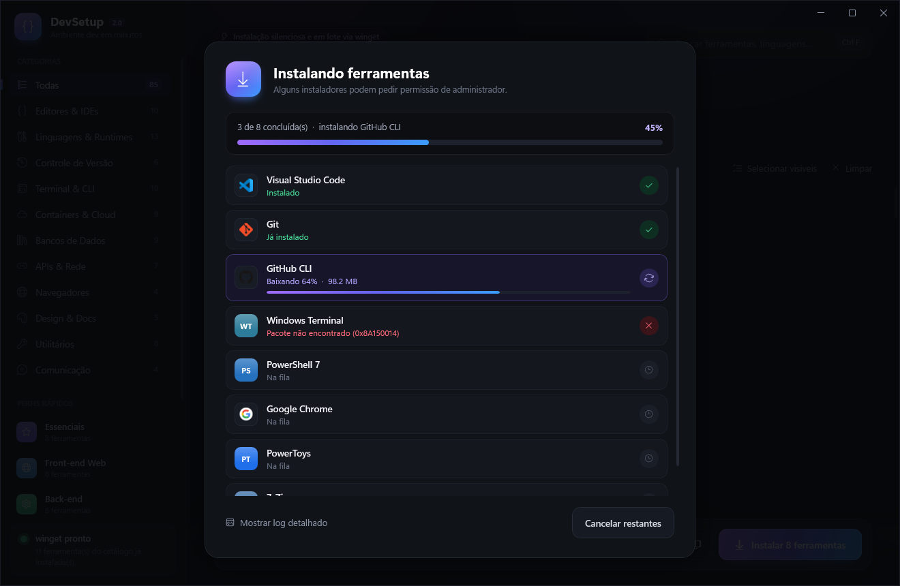

# DevSetup

Instalador visual para montar um ambiente de desenvolvimento no Windows: escolha as ferramentas e instale tudo de uma vez, em modo silencioso, via **winget**.


## Como usar

1. Baixe o repositório (ou `git clone`).
2. Dê dois cliques em **`Iniciar DevSetup.bat`**.
3. Selecione as ferramentas clicando nos cartões, ou use um **perfil rápido** na barra lateral.
4. Clique em **Instalar**.

> Dica: execute como administrador (botão direito → *Executar como administrador*) para evitar um pedido de UAC por instalador.



## Recursos

- **85 ferramentas** em 11 categorias, com logos, busca (`Ctrl+F`) e filtros: *Todas*, *Selecionadas*, *Não instaladas*
- **Perfis rápidos**: Essenciais, Front-end, Back-end, Python & Dados, Mobile, DevOps & Cloud, Java & .NET
- **Detecta o que já está instalado** e marca com o selo *Instalado*
- **Progresso em tempo real** por ferramenta (download em %, instalação, sucesso/falha) e log detalhado
- **Copiar comandos**: gera os comandos `winget install` da seleção
- Botão para abrir o site oficial de cada ferramenta
- Layout responsivo, animações suaves e tema escuro

## Personalizar

Tudo vem de **`tools.json`**:

```json
{ "id": "Git.Git", "name": "Git", "category": "Controle de Versão", "color": "#F05032",
  "desc": "Controle de versão distribuído + Git Bash.", "site": "https://git-scm.com", "keywords": "git bash" }
```

- `id`: identificador do winget (descubra com `winget search <nome>`)
- logo opcional: salve um PNG em `icons/<id>.png`; sem logo, aparecem as iniciais sobre `color`
- `presets`: listas de IDs para os perfis rápidos

## Requisitos

- Windows 10/11
- winget (*Instalador de Aplicativo* da Microsoft Store)
- Windows PowerShell 5.1 (já vem no Windows)

## Estrutura

| Arquivo | Função |
| --- | --- |
| `Iniciar DevSetup.bat` | Atalho para abrir o app |
| `DevSetup.ps1` | Lógica: catálogo, filtros, detecção e instalação em segundo plano |
| `MainWindow.xaml` | Interface WPF |
| `tools.json` | Catálogo de ferramentas e perfis |
| `icons/` | Logos das ferramentas |

Os logos pertencem às respectivas marcas e são usados apenas para identificação.
